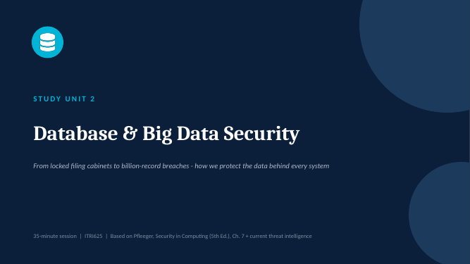

# Teaching Portfolio: Musawakhe (Wayne) Chipeya

Lessons I designed and delivered, plus a summary of my tutoring at North-West University. All materials are my own; textbook content is cited, not copied.

## Tutoring and marking (NWU, Vanderbijlpark)

| Module | Level | Role | Approx. students |
|---|---|---|---|
| CMPG223 Systems Analysis and Design II | 2nd year | Tutor and marker (eFundi additional instructor), 2025 | ~174 across two class sites |
| CMPG212 Apps and Advanced User Interface Programming | 2nd year | Tutor and marker (eFundi additional instructor), 2025 | ~101 |
| CMPG313 Artificial Intelligence | 3rd year | Tutor and marker | |
| CMPG221 Data Structures (Java) | 2nd year | Tutor and marker | |

**Project leadership (ITRI624, 2026):** coordinated a large CMPG323 class building the [Conference Management Tool](https://github.com/Waynemusawakhe/Conference-Management-Tool). The class was split into five teams (requirements and UI/UX, database, backend, frontend, QA and documentation), each with a team leader.

## Lessons

### [Database and Big Data Security](database-and-big-data-security) (ITRI625 Computer Security 2, 2026)

A 35-minute session covering three outcomes: access control in databases, protection of sensitive data (including the inference problem), and data mining and Big Data security.

- **[Slides](database-and-big-data-security/slides.pdf)** (28 slides, [editable .pptx](database-and-big-data-security/slides.pptx)), with South African and global breach case studies tying the headlines back to theory
- **Built-in knowledge check:** a five-question quiz, Kahoot style
- **[Presenter script](database-and-big-data-security/presenter-script.pdf)** with per-slide timing, delivery cues and a pacing plan for the 35 minutes

## Teaching-ready code

- [Java data structures](https://github.com/Waynemusawakhe/java-data-structures): hand-built lists, stack, queue and sorting, with tests and cost notes. This is the kind of worked example used in CMPG221 tutorials.
- [AI coursework](https://github.com/Waynemusawakhe/ai-coursework): small, explained examples of clustering and logic-based inference
